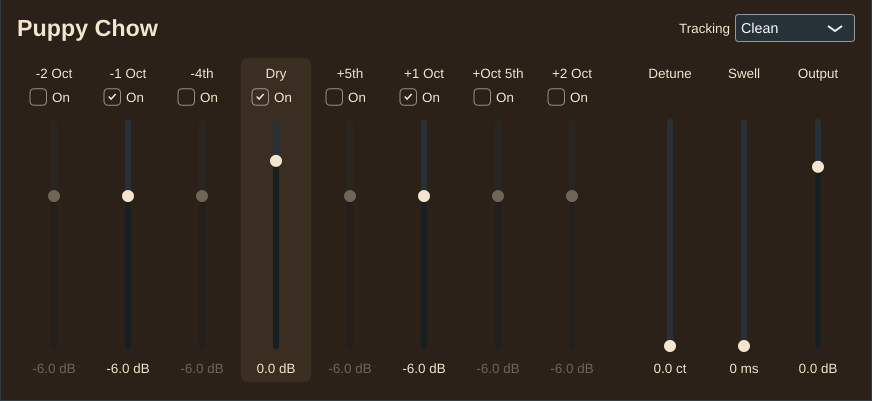

# Puppy Chow

A polyphonic octave pedal for guitar, as a Mac Audio Unit (plus VST3 and a standalone app).
It's meant to sit in front of your amp sim and add clean, chord-friendly octaves up and down.

## Status

**Milestone 3: more voices and controls.** The interface is still a placeholder.



- **Eight channels**, each with an on/off switch and a level slider: two octaves down, one
  octave down, a fourth down, Dry, a fifth up, one octave up, an octave plus a fifth up, and
  two octaves up.
- **Detune** adds slightly sharp copies of the two octave-up voices for a 12-string shimmer.
- **Swell** fades the voices in after each picked note, like a volume swell or a bowed string.
- **Output** sets the overall level. A gentle limiter rounds off peaks above about -2 dBFS so
  stacked voices on a hard strum never overload whatever comes next.
- **Tracking** trades speed for cleanliness. *Tight* responds fastest, *Clean* keeps low and
  close-voiced chords clearest but lets the voices bloom in more slowly, and *Balanced* sits
  between them.

Still to come: a Tone filter, and a proper interface.

Design goals:
- Feels like a pedal, not a delay. Your dry signal is never delayed. The voices fade in over
  a few tens of milliseconds, faster for high notes and in Tight mode.
- Tracks chords cleanly, with no pitch detection. Notes a semitone apart are the known weak
  spot.
- Light on CPU, and safe to run on the real-time audio thread.

## How it works

The guitar signal is split into 140 to 220 very narrow frequency bands (depending on the
Tracking mode), so each band holds roughly one pure tone from one string. Each tone is then
moved to its new pitch on its own and the results are added back together. Because nothing ever has to decide "which note
is this?", chords work as well as single notes. The engine lives in `src/dsp/OctaveEngine.h`
and has no dependencies. `tests/engine_tests.cpp` checks pitch accuracy, chord cleanliness,
attack time and CPU use.

## Building on a Mac

You need Xcode (or the Xcode command line tools), CMake and Ninja (`brew install cmake ninja`).

```sh
cmake -S . -B build -G Ninja -DCMAKE_BUILD_TYPE=Release
cmake --build build
ctest --test-dir build          # engine tests; add --verbose to see every measurement
```

The first configure downloads JUCE, so it takes a minute. Plugins end up in
`build/PuppyChow_artefacts/Release/`. To use the Audio Unit in your DAW, copy
`AU/Puppy Chow.component` into `~/Library/Audio/Plug-Ins/Components/`, then check it with:

```sh
auval -v aufx Pchw Jdrg
```

## Getting a build without compiling

Every push to `main` builds the plugin on GitHub Actions, runs the engine tests, and validates
it with `auval` and `pluginval`. Download the `PuppyChow-macOS` artifact from the latest run on
the Actions tab. Those builds are not code-signed, so macOS may block them the first time; run
`xattr -dr com.apple.quarantine "Puppy Chow.component"` after copying it in.

Built with [JUCE](https://juce.com).
