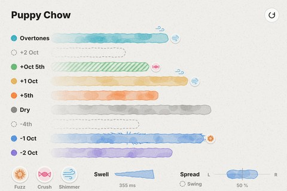

# Potluck Audio

My audio plugins for the Mac, as Audio Units (plus VST3 and standalone apps), built with
[JUCE](https://juce.com) and CMake.

| | Plugin | What it is | Latest |
| --- | --- | --- | --- |
|  | [Puppy Chow](plugins/puppy-chow/README.md) | A polyphonic octave pedal for guitar, to sit in front of an amp sim | [Releases](https://github.com/jdragash/potluck-audio/releases) |
