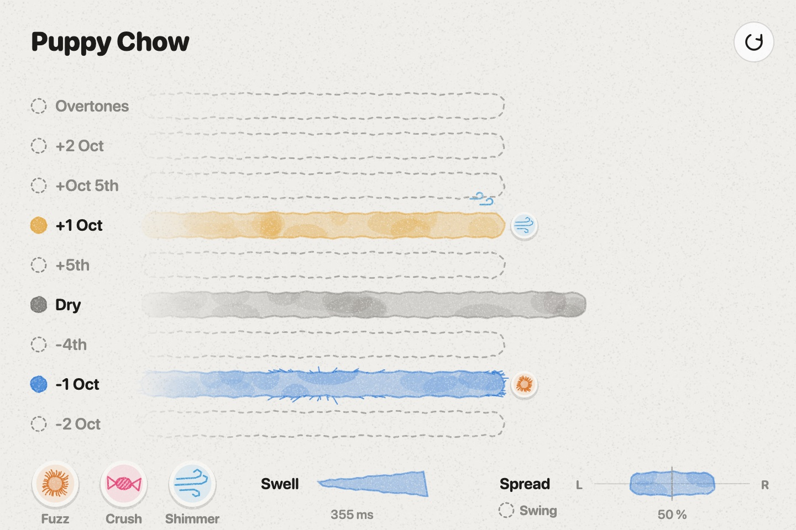
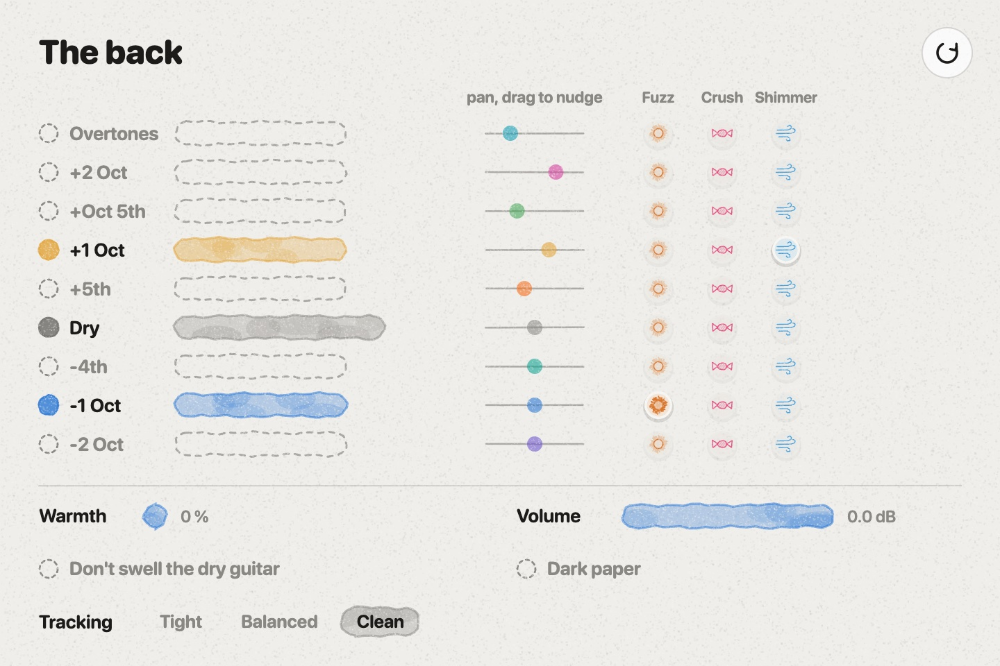

# Puppy Chow

A polyphonic octave pedal for guitar, as a Mac Audio Unit (plus VST3 and a standalone app).
It's meant to sit in front of your amp sim and add clean, chord-friendly octaves up and down.

## Status

**Version 0.4.0.** Download it from the [Releases](https://github.com/jdragash/potluck-audio/releases)
page. 0.4.0 brings the real, hand-drawn interface.



**The front** is one stack of voices, highest on top:

- **Nine voices**: two octaves down, one octave down, a fourth down, Dry, a fifth up, one
  octave up, an octave plus a fifth up, two octaves up, and Overtones. A crayon wash shows
  each voice's level; sweep down the stack to draw a whole tone in one go. Tap a voice's
  light to switch it off (it goes dashed and keeps its level).
- **Overtones** ("ghost partials") adds the 7th, 9th, 11th and 13th harmonics of what you
  play. They sit between the notes of a piano, so they shimmer in a way no fretted note can.
- **Stickers**: drag one onto any voice, Dry included, and mix them freely. The fuzz ball is
  *Fuzz* (hard, lopsided clipping with a tone filter), the candy is *Crush* (lo-fi bit and
  sample-rate reduction) and the puff of air is *Shimmer* (a lush stereo reverb tail that
  rings on after you stop).
- **Swell** fades the voices in after each picked note, like a volume swell or a bowed
  string. It swells the dry guitar too, unless you switch that off on the back.
- **Spread** fans the voices above the dry guitar out across the stereo field, higher voices
  wider, alternating sides. Lows and Dry stay centred.
- **Swing** (off by default) lets the spread voices drift slowly side to side, each at its
  own speed.



**The back** (tap the round arrow to flip the page) has the details:

- Levels, a **pan nudge** on top of Spread, and the stickers for every voice.
- **Warmth** adds soft tape-style saturation and a darker top to the voices above the dry
  guitar, so they sound less digital.
- **Volume** sets the overall level. A gentle limiter rounds off peaks above about -2 dBFS so
  stacked voices on a hard strum never overload whatever comes next.
- **Don't swell the dry guitar** keeps the dry signal at full level while the voices swell.
- **Dark paper** switches the interface from light to dark. It's saved with the plugin.
- **Tracking** trades speed for cleanliness. *Tight* responds fastest, *Clean* keeps low and
  close-voiced chords clearest but lets the voices bloom in more slowly, and *Balanced* sits
  between them.

Still to come: a Tone filter.

Design goals:
- Feels like a pedal, not a delay. Your dry signal is never delayed. The voices fade in over
  a few tens of milliseconds, faster for high notes and in Tight mode.
- Tracks chords cleanly, with no pitch detection. Notes a semitone apart are the known weak
  spot.
- Light on CPU, and safe to run on the real-time audio thread.

## How it works

The guitar signal is split into 140 to 220 very narrow frequency bands (depending on the
Tracking mode), so each band holds roughly one pure tone from one string. Each tone is then
moved to its new pitch on its own and the results are added back together. Because nothing ever has to decide "which note
is this?", chords work as well as single notes. The engine lives in `src/dsp/OctaveEngine.h`
and has no dependencies. `tests/engine_tests.cpp` checks pitch accuracy, chord cleanliness,
attack time and CPU use.

## Building on a Mac

Puppy Chow lives in the [Potluck Audio](../../README.md) repo. You need Xcode (or the Xcode
command line tools), CMake and Ninja (`brew install cmake ninja`). From the repo root:

```sh
cmake -S . -B build -G Ninja -DCMAKE_BUILD_TYPE=Release -DPLUGINS=puppy-chow
cmake --build build
ctest --test-dir build -R puppy-chow   # engine and host tests; add --verbose to see every measurement
```

The first configure downloads JUCE, so it takes a minute. Plugins end up in
`build/plugins/puppy-chow/PuppyChow_artefacts/Release/`. To use the Audio Unit in your DAW, copy
`AU/Puppy Chow.component` into `~/Library/Audio/Plug-Ins/Components/`, then check it with:

```sh
auval -v aufx Pchw Jdrg
```

## Getting a build without compiling

Every push to `main` and every pull request that touches Puppy Chow (or the shared code) builds it on GitHub Actions, runs the engine,
host and stress tests, and validates
it with `auval` and `pluginval`. Download the `PuppyChow-macOS` artifact from the latest run on
the Actions tab. Those builds are not code-signed, so macOS may block them the first time; run
`xattr -dr com.apple.quarantine "Puppy Chow.component"` after copying it in.

## Versions and testing

Each version is listed in [CHANGELOG.md](CHANGELOG.md), and the version number shows in the bottom
right corner of the back of the plugin. Finished, tested versions are on the [Releases](https://github.com/jdragash/potluck-audio/releases)
page as a zip with the Audio Unit, VST3 and standalone app.

How a change gets there:

1. New work goes on its own branch, never straight to `main`. GitHub builds and checks every
   branch, but nothing on a branch is a release.
2. That branch is built and installed on Jake's Mac so he can play it.
3. Only once Jake says it's good: the branch is merged into `main`, the version number is
   raised in `plugins/puppy-chow/CMakeLists.txt` and `CHANGELOG.md`, and a
   `puppy-chow-vX.Y.Z` tag is pushed. The tag builds the release automatically. (Versions up
   to 0.4.0 were tagged plain `vX.Y.Z`, before the repo held more than one plugin.)

Built with [JUCE](https://juce.com).
